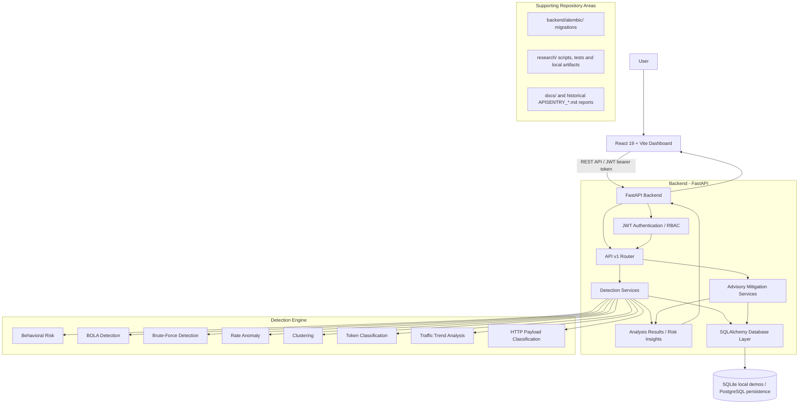

# APISentry AI

### Intelligent API Security Monitoring and Threat Detection System

APISentry AI is an API security monitoring and threat detection platform designed to analyze API traffic, identify suspicious request patterns, and generate security insights through a web-based dashboard.

The system combines behavioral analysis, rule-based detection, anomaly detection, and machine learning techniques to identify potentially malicious API activity.

It consists of a **FastAPI backend**, a **React frontend**, and a database layer using **SQLAlchemy and PostgreSQL**.

Research dataset and controlled-collection documentation is maintained in
[research/README.md](research/README.md), with the current Stage 7 handoff in
[research/STAGE_7_HANDOFF.md](research/STAGE_7_HANDOFF.md).

---

## Table of Contents

1. [Project Overview](#project-overview)
2. [Objectives](#objectives)
3. [Key Features](#key-features)
4. [System Architecture](#system-architecture)
5. [Detection Modules](#detection-modules)
6. [Technology Stack](#technology-stack)
7. [Project Structure](#project-structure)
8. [Installation and Setup](#installation-and-setup)
9. [Running the Application](#running-the-application)
10. [API Security](#api-security)
11. [Testing](#testing)
12. [Limitations](#limitations)
13. [Future Enhancements](#future-enhancements)
14. [Project Team](#project-team)

---

## Project Overview

Modern applications rely heavily on APIs to exchange information between frontend applications, backend services, and external systems.

However, APIs can be exposed to several security risks, including:

- Broken Object Level Authorization (BOLA).
- Brute-force attempts.
- Abnormal request rates.
- Suspicious user behavior.
- Token-related security issues.
- Unusual API traffic patterns.

Traditional API monitoring often focuses on availability and performance. APISentry AI focuses on analyzing API request behavior and identifying potentially suspicious activity.

The platform processes API traffic through multiple detection modules and generates security-related insights to help developers understand potential threats.

---

## Objectives

The primary objectives of APISentry AI are:

- Analyze API request patterns and identify suspicious behavior.
- Detect potentially malicious API activity using multiple detection techniques.
- Identify abnormal traffic patterns and request-rate anomalies.
- Detect possible BOLA and brute-force attack patterns.
- Classify suspicious activity using risk levels.
- Provide a centralized dashboard for monitoring API security insights.
- Secure sensitive backend operations using authentication and API key protection.
- Maintain structured data through a database layer.
- Support automated testing of backend functionality.

---

## Key Features

### 1. Multiple Threat Detection Modules

The system contains seven detection modules that analyze different aspects of API traffic.

### 2. Behavioral Analysis

Analyzes request behavior and identifies unusual activity that may indicate suspicious usage.

### 3. BOLA Detection

Identifies potentially suspicious object-level access patterns that may indicate Broken Object Level Authorization vulnerabilities.

### 4. Brute-Force Detection

Analyzes repeated request attempts to identify patterns associated with brute-force activity.

### 5. Rate Anomaly Detection

Identifies unusual request frequencies and abnormal traffic rates.

### 6. Clustering-Based Analysis

Uses clustering techniques to identify groups and patterns within API traffic data.

### 7. Token Classification

Analyzes token-related characteristics to support security classification.

### 8. Traffic Trend Analysis

Analyzes API traffic trends to identify unusual patterns and changes in request activity.

### 9. Authentication and API Security

Includes JWT-based authentication and API key protection for sensitive backend operations.

### 10. Interactive Dashboard

Provides a React-based frontend for interacting with the backend and viewing API security information.

---

## System Architecture

The following diagram illustrates the high-level architecture of APISentry AI.



### Architecture Explanation

**Frontend Layer**

- Built using React and Vite.
- Provides the user interface and dashboard.
- Communicates with the backend through a centralized API client using JWT bearer tokens.
- Does not configure or send browser API keys.

**Backend Layer**

- Built using FastAPI with JWT authentication and role-based access control.
- Provides API endpoints and connects detection, mitigation, and persistence services.
- Includes an optional server-to-server API-key dependency for non-browser clients.
- Keeps Gate E and WP9 demo control planes isolated and default-disabled.
- Does not register production request-time enforcement middleware; enforcement remains advisory-only.

**Detection Engine**

- Contains seven primary detection modules plus artifact-gated HTTP payload classification.
- Analyzes API traffic using rule-based, behavioral, statistical, and machine-learning-assisted approaches.
- Produces advisory security insights, not definitive attack proof.

**Mitigation Services**

- Provides policy lifecycle, validation, dry-run, decision, audit, and runtime-analysis services.
- Results are advisory-only in the default application.

**Database Layer**

- Uses SQLAlchemy for database operations.
- Uses SQLite for isolated local demos/tests and PostgreSQL for persistent validation.
- Keeps production schema auto-creation disabled; schema changes require explicit reviewed Alembic operations.

**Research and Documentation Areas**

- `research/` contains scripts, tests, local datasets, and model artifacts used for research and reproducibility.
- Large raw dataset and model artifacts are excluded from the frozen GitHub contribution.
- `docs/` and historical `APISENTRY_*.md` reports preserve runbooks, checkpoints, and verified evidence snapshots.

---

## Detection Modules

| Module | Purpose |
|---|---|
| Behavioral Risk | Identifies unusual API request behavior. |
| BOLA Detection | Identifies potentially suspicious object-level access patterns. |
| Brute-Force Detection | Detects repeated attempts that may indicate brute-force activity. |
| Rate Anomaly | Identifies abnormal request frequencies. |
| Clustering | Groups traffic patterns using clustering techniques. |
| Token Classification | Analyzes token-related characteristics. |
| Traffic Trends | Analyzes API traffic patterns and changes over time. |

Each module focuses on a different category of API security analysis. Their combined results provide a broader view of potentially suspicious API activity.

---

## Technology Stack

### Backend

| Technology | Purpose |
|---|---|
| Python | Core programming language |
| FastAPI | Backend REST API framework |
| SQLAlchemy | Database ORM |
| PostgreSQL | Relational database |
| Pydantic | Data validation and settings |
| JWT | Token-based authentication |
| NumPy | Numerical operations |
| Scikit-learn | Machine learning and clustering |
| PyTorch | Machine learning support |
| Pytest | Backend testing |
| HTTPX | API testing |

### Frontend

| Technology | Purpose |
|---|---|
| React 19 | Frontend library |
| Vite | Frontend development and build tool |
| JavaScript | Application logic |
| HTML | Page structure |
| CSS | Styling |

### Development Tools

- Git and GitHub
- Visual Studio Code
- PowerShell
- Python Virtual Environment
- npm

---

## Project Structure

```text
API-SENTRY-AI/
|
|-- backend/
|   |-- alembic/                  # migration environment and revisions
|   |-- app/
|   |   |-- api/                  # v1 routes, including mitigation services
|   |   |-- core/                 # configuration, security, rate limiting
|   |   |-- db/                   # SQLAlchemy session and initialization
|   |   |-- detection/            # behavioral, BOLA, brute-force, anomaly modules
|   |   |-- models/               # persisted data models
|   |   |-- schemas/              # request/response and lifecycle schemas
|   |   |-- services/             # detection, mitigation, persistence services
|   |   `-- utils/                # shared helpers and middleware support
|   |-- models/                   # local model artifacts
|   |-- scripts/                  # optional manual and training utilities
|   |-- tests/                    # backend automated tests
|   |-- .env.example
|   `-- requirements.txt
|
|-- frontend/
|   |-- public/
|   |-- src/                      # React dashboard, components and API client
|   |-- tests/                    # frontend node tests
|   |-- package.json
|   `-- vite.config.js
|
|-- docs/                         # deployment, reproducibility and review docs
|-- research/
|   |-- datasets/raw/             # local research datasets; large files excluded from contribution
|   |-- models/                   # local classifier artifacts; excluded from contribution
|   |-- scripts/                  # research training/prediction scripts
|   |-- tests/                    # optional research suite
|   `-- README.md
|-- APISENTRY_*.md                 # historical snapshot reports
|-- scripts/                      # project utility scripts
`-- README.md
```

### Directory Description

**backend/alembic/**

Contains the migration environment and schema revisions. Migrations are applied only through explicit reviewed operations.

**backend/app/api/**

Contains API routes and endpoint-related functionality, including authentication, detection, advisory mitigation, policy administration, and default-disabled demo control planes.

**backend/app/core/**

Contains core application configuration, JWT/RBAC security, rate limiting, and middleware support.

**backend/app/db/**

Contains database configuration, session management, and initialization guards.

**backend/app/detection/**

Contains the primary API security detection modules.

**backend/app/models/**

Contains application data models.

**backend/app/schemas/**

Contains data validation schemas and lifecycle contracts.

**backend/app/services/**

Contains detection, mitigation, persistence, artifact-policy, and advisory service logic.

**backend/app/utils/**

Contains reusable utility functions.

**backend/tests/**

Contains backend automated tests, including the safe default suite and the separately gated PostgreSQL lifecycle test.

**backend/scripts/**

Contains optional manual and training utilities. These are not part of normal application startup.

**frontend/src/**

Contains the React frontend source code and centralized API client.

**frontend/tests/**

Contains frontend node tests.

**docs/**

Contains deployment, reproducibility, evaluation, and review documentation.

**research/**

Contains optional research scripts, tests, local datasets, and model artifacts. Large raw dataset/model artifacts are excluded from the frozen GitHub contribution.

**APISENTRY_\*.md**

Contains historical snapshot reports. Their original test counts are intentionally preserved as historical evidence.

**scripts/**

Contains project utility scripts.

---

## Installation and Setup

### Prerequisites

Install the following before running the project:

- Python 3.10 or later.
- Node.js and npm.
- PostgreSQL.
- Git.

### 1. Clone the Repository

```bash
git clone https://github.com/singhsanya2303-eng/APISentry-AI.git
```

Navigate to the project directory:

```bash
cd APISentry-AI
```

### 2. Backend Setup

Create a Python virtual environment:

**Windows PowerShell**

```powershell
python -m venv .venv
```

Activate the environment:

```powershell
.\.venv\Scripts\Activate.ps1
```

Install backend dependencies:

```powershell
pip install -r backend/requirements.txt
```

### 3. Environment Configuration

Create your local environment configuration using the provided example:

```powershell
Copy-Item backend/.env.example backend/.env
```

Update the environment variables according to your local configuration.

Configure the required database connection and security settings.

**Important:** Never commit real database passwords, API keys, JWT secrets, or other sensitive credentials to GitHub.

### 4. Frontend Setup

Navigate to the frontend directory:

```powershell
cd frontend
```

Install frontend dependencies:

```powershell
npm install
```

Return to the project root:

```powershell
cd ..
```

---

## Running the Application

The backend and frontend run as separate development servers.

### 1. Start the Backend

Open a terminal at the project root.

Activate the virtual environment:

```powershell
.\.venv\Scripts\Activate.ps1
```

Set the Python module path:

```powershell
$env:PYTHONPATH = (Get-Location).Path
```

Start the FastAPI server:

```powershell
python -m uvicorn app.main:app --app-dir .\backend --reload
```

Backend URL:

```text
http://localhost:8000
```

FastAPI interactive documentation:

```text
http://localhost:8000/docs
```

### 2. Start the Frontend

Open another terminal:

```powershell
cd frontend
```

Start the Vite development server:

```powershell
npm run dev
```

Frontend URL with the repository's Vite configuration:

```text
http://localhost:5173
```

`frontend/vite.config.js` does not override the Vite port, so `npm run dev` uses
Vite's default `5173`. The backend development CORS template in
`backend/.env.example` and non-production `create_app()` both include
`5173` and `5174` loopback origins; no manual origin edit is needed for the
default port. If you use a different local port, add that exact browser origin
to your local `CORS_ORIGINS`. Production builds are validated separately and
require an explicit HTTPS origin. Neither loopback port is a production
configuration.

### 3. Local brute-force demonstration (non-production only)

`scripts/simulate_bruteforce_demo.py` generates failed logins against
`POST /demo/auth/login` and then queries the brute-force analysis endpoint.
That demo endpoint is **disabled by default** and is never available in
production. Enable it only on a local, non-production server:

1. Confirm `ENVIRONMENT` is not `production` (for example, `development`).
2. Set `APISENTRY_ENABLE_DEMO_AUTH=True` in your local `backend/.env`.
3. Choose a fresh `DEMO_PASSWORD` and set it locally. Do not reuse a real
   credential.
4. Restart the backend. The demo route is registered at startup, so a running
   server must be restarted after changing these settings.
5. Open `http://localhost:8000/docs` and confirm `POST /demo/auth/login` is
   listed. A 404 or a missing entry means the flag, password, or environment
   is not set correctly. Keep the demo server bound to localhost and never
   expose a demo-auth server publicly.

The simulator has no built-in API key. Supply one explicitly at run time,
either through the `APISENTRY_DEMO_API_KEY` environment variable (preferred,
because it keeps the value out of shell history) or with `--api-key`:

```powershell
$env:APISENTRY_DEMO_API_KEY = <key supplied out of band>
python scripts/simulate_bruteforce_demo.py

# Alternative:
python scripts/simulate_bruteforce_demo.py --api-key <key supplied out of band>
```

If neither source is provided, the simulator exits with a clear error before
making any request. It never prints or logs the key. Do not paste real keys
into files, shell scripts, or documentation, and never commit credentials.

After the presentation, set `APISENTRY_ENABLE_DEMO_AUTH=false`, clear
`DEMO_PASSWORD`, and restart the backend. Verify `POST /demo/auth/login`
returns 404 and no longer appears in `/docs`.

---

## API Security

APISentry AI implements authentication and access protection for backend operations.

### JWT Authentication

JSON Web Tokens are used for token-based authentication. JWT authentication
helps the application identify authenticated users and control access to
protected functionality.

User accounts are persisted through the SQLAlchemy database layer when a
configured database is available. The in-memory user registry remains a
compatibility/fallback path for local and test tokens, not the primary
production store. Role-based access control (Admin, Analyst, Viewer) is
implemented for protected routes. PostgreSQL durability across restarts and
workers still requires separate verification, and passing local tests does not
establish production readiness.

### API Key Protection

API key validation is implemented to protect sensitive backend operations.

Protected requests must provide the expected API key through the appropriate request header.

Example header format:

```http
x-api-key: YOUR_API_KEY
```

The actual API key must be configured locally and must not be exposed in public repositories.

---

## Database Schema and Migrations (Phase 0)

Alembic manages the reviewed baseline revision
`0001_baseline_existing_schema`. The baseline represents the existing
`users` and `api_traffic_logs` tables, their columns, primary keys, unique and
non-unique indexes, and the documented ad hoc index creation in
`init_db()`. It does **not** create mitigation tables and does not implement
enforcement.

The Alembic environment has no embedded connection string. The single URL
source is `Settings.get_database_url()`; credentials and DSNs are never
printed or logged. `alembic.ini` uses `%(here)s` paths and SQLite batch
migrations are enabled.

### Fresh database

Use a new, empty database only. From the project root:

```powershell
.\.venv\Scripts\Activate.ps1
$env:PYTHONPATH = (Get-Location).Path + '\backend'
alembic -c backend/alembic.ini upgrade head
python -m app.scripts.verify_baseline
```

The upgrade creates both tables and the `alembic_version` marker. The verifier
is read-only and exits `0` for PASS and `1` for FAIL. A fresh upgrade must
report `SCHEMA_MATCHES_BASELINE`.

### Existing database

Never assume an existing database matches the baseline. Do not run `upgrade`
or `stamp` first. Run the read-only verifier against an explicitly configured
target:

```powershell
$env:PYTHONPATH = (Get-Location).Path + '\backend'
python -m app.scripts.verify_baseline
```

A FAIL report gives actionable reason codes such as `MISSING_TABLE`,
`MISSING_COLUMN`, `UNEXPECTED_COLUMN`, `MISSING_INDEX`, `UNEXPECTED_INDEX`,
`INDEX_DEFINITION_MISMATCH`, `PRIMARY_KEY_MISMATCH`,
`COLUMN_TYPE_MISMATCH`, `COLUMN_NULLABILITY_MISMATCH`,
`UNEXPECTED_UNIQUE_CONSTRAINT`, `UNEXPECTED_CHECK_CONSTRAINT`,
`UNEXPECTED_FOREIGN_KEY`, and `DATABASE_INSPECTION_FAILED`. The report contains
schema object names only: no records, emails, usernames, password hashes, IP
addresses, request IDs, API keys, or credentials. Known Alembic metadata is
reported as `KNOWN_ADDITIONAL_OBJECT` rather than treated as an error.

Investigate every unexplained difference before any change. Only a verified
existing database may be stamped, and stamping must be a separate, explicitly
reviewed operation with a verified backup:

```powershell
alembic -c backend/alembic.ini stamp 0001_baseline_existing_schema
```

The verifier never stamps automatically. A data checksum is intentionally
deferred (`DATA_CHECKSUM_DEFERRED`): it requires deterministic canonicalization
and a securely managed key outside the database. Do not substitute a weak
checksum.

### Production safety

`AUTO_CREATE_SCHEMA` defaults to `True` so local development and tests keep
working. Production settings force it to `False`. FastAPI startup never runs
Alembic, and skips `init_db()` whenever the gate is disabled or the
environment is production. `init_db()` itself raises in production as defence
in depth. Apply schema changes only through explicit, reviewed Alembic
operations against a backed-up target.

The baseline deliberately refuses automatic downgrade. Recovery from a
baseline state must be an explicit restore from a verified backup or a
separately reviewed correction; do not use `downgrade` as a rollback mechanism.

---

## Testing

Run the documented verification commands from the repository root unless a
command explicitly states otherwise. No external database, server, or
dependency installation is required for these checks.

### Backend Safe Suite

The backend uses Pytest. Run the supported safe suite from the repository root:

```powershell
.\.venv\Scripts\python.exe -B -m pytest -p no:cacheprovider -q backend/tests --ignore=backend/tests/test_mitigation_policy_lifecycle_persistence.py --ignore=backend/tests/test_alembic_baseline.py
```

`backend/tests/test_mitigation_policy_lifecycle_persistence.py` is separately
gated because it requires PostgreSQL persistence testing, and
`backend/tests/test_alembic_baseline.py` is gated because it exercises revision
history. Both are intentionally excluded from this safe command. Do not run
them against a protected or unapproved database.

The latest verified result for the safe suite is:

```text
1545 passed, 29 warnings in 122.78s
```

The warnings are dependency/deprecation warnings and did not indicate test
failures. Local test success does not establish production readiness.

### Research Suite

Run the optional research suite from the repository root; invoking it from a
nested directory is not supported because its fixture paths assume the
repository root as the working directory:

```powershell
.\.venv\Scripts\python.exe -B -m pytest -p no:cacheprovider -q research/tests
```

The latest verified result is:

```text
157 passed
```

### Frontend Checks

Run frontend tests from the repository root:

```powershell
node --test frontend/tests/*.test.js
```

The latest verified result is:

```text
52 pass, 0 fail
```

Run lint checks from the repository root:

```powershell
npm --prefix frontend run lint
```

A production build was also verified successfully in a unique temporary output
directory outside the repository:

```powershell
npm --prefix frontend run build -- --outDir <unique-external-temp-directory>
```

Do not use `--emptyOutDir` for that external-output verification. The build
check confirms that production assets can be generated; it does not mean
`frontend/dist` was regenerated or modified in the contribution.

### Release candidate documentation

Repository-side release preparation, without any deployment or publication
action, is recorded in:

- [docs/FINAL_RELEASE_RUNBOOK.md](docs/FINAL_RELEASE_RUNBOOK.md) — local verification evidence, acceptance gates, and limitations.
- [docs/OWNER_SETUP_CHECKLIST.md](docs/OWNER_SETUP_CHECKLIST.md) — owner-controlled Cloudflare Pages, Render, and Neon setup steps.
- [docs/DEMO_GUIDE.md](docs/DEMO_GUIDE.md) — role-aware walkthrough and demo boundaries.

These documents do not authorize or perform provider account creation, DNS
changes, database migration, deployment, or public release.

### Offline model training

The backend includes a leakage-safe offline training utility at
`backend/app/services/ml_training_service.py`. It accepts a caller-supplied,
verified tabular dataset, validates finite numeric features and class labels,
creates stratified training/validation/test partitions, fits preprocessing
only on the training partition, and persists the scaler, model, feature names,
and artifact version with `joblib`.

The utility does not acquire data or create evaluation claims by itself.
Metrics returned by the workflow describe only the held-out rows supplied by
the caller. Local research artifacts may exist under `research/datasets/raw/`
and `research/models/`, but the large raw dataset and model artifacts are
excluded from the frozen GitHub contribution. They must not be assumed to be
licensed or approved for redistribution; dataset licensing, provenance, and
publication approval remain owner-review items. Local artifact availability
does not by itself establish a completed real-world evaluation claim.

The React dashboard uses the centralized client in
`frontend/src/services/api.js`. Configure `VITE_API_BASE_URL` if the backend
is not at the default local address. Protected analysis routes use the
signed-in user's JWT bearer token from `frontend/src/services/tokenStorage.js`;
do not configure a shared API key for the browser build, because a
browser-delivered key is not a secret. Server-to-server API keys remain
configured only in the backend environment.

---

## Limitations

The current implementation has some limitations:

- Detection accuracy depends on the quality and completeness of the API traffic data supplied to the system.
- Detection results should be treated as potential security indicators, not definitive proof of an attack.
- Detection quality requires evaluation against representative real-world traffic.
- Persistent database-backed user storage exists; the in-memory registry is a compatibility/fallback path rather than the primary production store.
- The platform is a monitoring and analysis project; it does not automatically prevent or block attacks against external production APIs.
- Demonstration or sample traffic does not establish real-world attack detection effectiveness.

---

## Future Enhancements

Potential improvements include:

1. Advanced anomaly detection using larger and more representative datasets.
2. Improved detection accuracy through model evaluation and tuning.
3. Real-time API traffic monitoring.
4. Automated alerts for high-risk activity.
5. Detailed security reports and export functionality.
6. Improved dashboard visualizations.
7. Integration with external security monitoring tools.
8. Production deployment validation, Docker/cloud rollout, and operational sign-off.

---

## Project Status

APISentry AI is an academic software project focused on API security monitoring, behavioral analysis, and threat detection.

The current implementation includes a FastAPI backend, React frontend, database integration, seven primary detection modules, mitigation/runtime services, persistent user management, role-based access control, authentication mechanisms, and automated backend tests.

The project demonstrates how different detection techniques can be combined into a centralized API security analysis platform. These are implemented capabilities, not a production-readiness claim: production request-time enforcement remains disabled/advisory-only, and Gate E and WP9 are isolated, default-disabled demonstrations.

---

## Project Team

- Prityush Pal
- Ishika Bharti
- Sanya Singh

GitHub: [@singhsanya2303-eng](https://github.com/singhsanya2303-eng)

Project Repository: [APISentry AI](https://github.com/singhsanya2303-eng/APISentry-AI)

---

*APISentry AI - Intelligent API Security Monitoring and Threat Detection.*