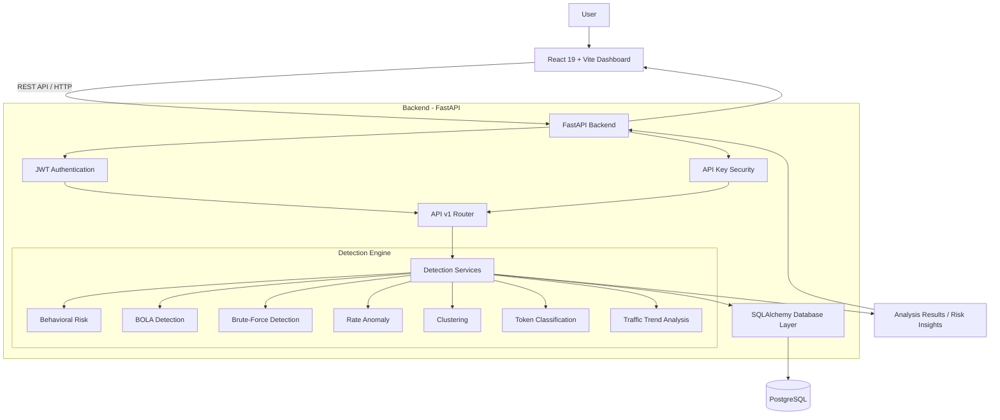

# APISentry AI

### Intelligent API Security Monitoring and Threat Detection System

APISentry AI is an API security monitoring and threat detection platform designed to analyze API traffic, identify suspicious request patterns, and generate security insights through a web-based dashboard.

The system combines behavioral analysis, rule-based detection, anomaly detection, and machine learning techniques to identify potentially malicious API activity.

It consists of a **FastAPI backend**, a **React frontend**, and a database layer using **SQLAlchemy and PostgreSQL**.

Research dataset and controlled-collection documentation is maintained in
[research/README.md](research/README.md), with the current Stage 7 handoff in
[research/STAGE_7_HANDOFF.md](research/STAGE_7_HANDOFF.md).

---

## Table of Contents

1. [Project Overview](#project-overview)
2. [Objectives](#objectives)
3. [Key Features](#key-features)
4. [System Architecture](#system-architecture)
5. [Detection Modules](#detection-modules)
6. [Technology Stack](#technology-stack)
7. [Project Structure](#project-structure)
8. [Installation and Setup](#installation-and-setup)
9. [Running the Application](#running-the-application)
10. [API Security](#api-security)
11. [Testing](#testing)
12. [Limitations](#limitations)
13. [Future Enhancements](#future-enhancements)
14. [Author](#author)

---

## Project Overview

Modern applications rely heavily on APIs to exchange information between frontend applications, backend services, and external systems.

However, APIs can be exposed to several security risks, including:

- Broken Object Level Authorization (BOLA).
- Brute-force attempts.
- Abnormal request rates.
- Suspicious user behavior.
- Token-related security issues.
- Unusual API traffic patterns.

Traditional API monitoring often focuses on availability and performance. APISentry AI focuses on analyzing API request behavior and identifying potentially suspicious activity.

The platform processes API traffic through multiple detection modules and generates security-related insights to help developers understand potential threats.

---

## Objectives

The primary objectives of APISentry AI are:

- Analyze API request patterns and identify suspicious behavior.
- Detect potentially malicious API activity using multiple detection techniques.
- Identify abnormal traffic patterns and request-rate anomalies.
- Detect possible BOLA and brute-force attack patterns.
- Classify suspicious activity using risk levels.
- Provide a centralized dashboard for monitoring API security insights.
- Secure sensitive backend operations using authentication and API key protection.
- Maintain structured data through a database layer.
- Support automated testing of backend functionality.

---

## Key Features

### 1. Multiple Threat Detection Modules

The system contains seven detection modules that analyze different aspects of API traffic.

### 2. Behavioral Analysis

Analyzes request behavior and identifies unusual activity that may indicate suspicious usage.

### 3. BOLA Detection

Identifies potentially suspicious object-level access patterns that may indicate Broken Object Level Authorization vulnerabilities.

### 4. Brute-Force Detection

Analyzes repeated request attempts to identify patterns associated with brute-force activity.

### 5. Rate Anomaly Detection

Identifies unusual request frequencies and abnormal traffic rates.

### 6. Clustering-Based Analysis

Uses clustering techniques to identify groups and patterns within API traffic data.

### 7. Token Classification

Analyzes token-related characteristics to support security classification.

### 8. Traffic Trend Analysis

Analyzes API traffic trends to identify unusual patterns and changes in request activity.

### 9. Authentication and API Security

Includes JWT-based authentication and API key protection for sensitive backend operations.

### 10. Interactive Dashboard

Provides a React-based frontend for interacting with the backend and viewing API security information.

---

## System Architecture

The following diagram illustrates the high-level architecture of APISentry AI.



### Architecture Explanation

**Frontend Layer**

- Built using React and Vite.
- Provides the user interface and dashboard.
- Communicates with the backend through HTTP-based API requests.

**Backend Layer**

- Built using FastAPI.
- Handles incoming requests and application logic.
- Provides API endpoints and connects the detection modules.
- Implements authentication and API key security.

**Detection Engine**

- Contains seven individual detection modules.
- Analyzes API traffic using different detection approaches.
- Produces security-related analysis results.

**Database Layer**

- Uses SQLAlchemy for database operations.
- Uses PostgreSQL for persistent data storage.

---

## Detection Modules

| Module | Purpose |
|---|---|
| Behavioral Risk | Identifies unusual API request behavior. |
| BOLA Detection | Identifies potentially suspicious object-level access patterns. |
| Brute-Force Detection | Detects repeated attempts that may indicate brute-force activity. |
| Rate Anomaly | Identifies abnormal request frequencies. |
| Clustering | Groups traffic patterns using clustering techniques. |
| Token Classification | Analyzes token-related characteristics. |
| Traffic Trends | Analyzes API traffic patterns and changes over time. |

Each module focuses on a different category of API security analysis. Their combined results provide a broader view of potentially suspicious API activity.

---

## Technology Stack

### Backend

| Technology | Purpose |
|---|---|
| Python | Core programming language |
| FastAPI | Backend REST API framework |
| SQLAlchemy | Database ORM |
| PostgreSQL | Relational database |
| Pydantic | Data validation and settings |
| JWT | Token-based authentication |
| NumPy | Numerical operations |
| Scikit-learn | Machine learning and clustering |
| PyTorch | Machine learning support |
| Pytest | Backend testing |
| HTTPX | API testing |

### Frontend

| Technology | Purpose |
|---|---|
| React 19 | Frontend library |
| Vite | Frontend development and build tool |
| JavaScript | Application logic |
| HTML | Page structure |
| CSS | Styling |

### Development Tools

- Git and GitHub
- Visual Studio Code
- PowerShell
- Python Virtual Environment
- npm

---

## Project Structure

```text
API-SENTRY-AI/
|
|-- backend/
|   |-- app/
|   |   |-- api/
|   |   |-- core/
|   |   |-- db/
|   |   |-- detection/
|   |   |-- models/
|   |   |-- schemas/
|   |   |-- services/
|   |   `-- utils/
|   |
|   |-- models/
|   |-- tests/
|   |-- .env.example
|   `-- requirements.txt
|
|-- frontend/
|   |-- public/
|   |-- src/
|   |-- package.json
|   `-- vite.config.js
|
|-- scripts/
|
`-- README.md
```

### Directory Description

**backend/app/api/**

Contains API routes and endpoint-related functionality.

**backend/app/core/**

Contains core application configuration and security-related functionality.

**backend/app/db/**

Contains database configuration and connection-related functionality.

**backend/app/detection/**

Contains the API security detection modules.

**backend/app/models/**

Contains application data models.

**backend/app/schemas/**

Contains data validation schemas.

**backend/app/services/**

Contains application service logic.

**backend/app/utils/**

Contains reusable utility functions.

**backend/tests/**

Contains backend automated tests.

**frontend/src/**

Contains the React frontend source code.

**scripts/**

Contains project utility scripts.

---

## Installation and Setup

### Prerequisites

Install the following before running the project:

- Python 3.10 or later.
- Node.js and npm.
- PostgreSQL.
- Git.

### 1. Clone the Repository

```bash
git clone https://github.com/singhsanya2303-eng/APISentry-AI.git
```

Navigate to the project directory:

```bash
cd APISentry-AI
```

### 2. Backend Setup

Create a Python virtual environment:

**Windows PowerShell**

```powershell
python -m venv .venv
```

Activate the environment:

```powershell
.\.venv\Scripts\Activate.ps1
```

Install backend dependencies:

```powershell
pip install -r backend/requirements.txt
```

### 3. Environment Configuration

Create your local environment configuration using the provided example:

```powershell
Copy-Item backend/.env.example backend/.env
```

Update the environment variables according to your local configuration.

Configure the required database connection and security settings.

**Important:** Never commit real database passwords, API keys, JWT secrets, or other sensitive credentials to GitHub.

### 4. Frontend Setup

Navigate to the frontend directory:

```powershell
cd frontend
```

Install frontend dependencies:

```powershell
npm install
```

Return to the project root:

```powershell
cd ..
```

---

## Running the Application

The backend and frontend run as separate development servers.

### 1. Start the Backend

Open a terminal at the project root.

Activate the virtual environment:

```powershell
.\.venv\Scripts\Activate.ps1
```

Set the Python module path:

```powershell
$env:PYTHONPATH = (Get-Location).Path
```

Start the FastAPI server:

```powershell
python -m uvicorn app.main:app --app-dir .\backend --reload
```

Backend URL:

```text
http://localhost:8000
```

FastAPI interactive documentation:

```text
http://localhost:8000/docs
```

### 2. Start the Frontend

Open another terminal:

```powershell
cd frontend
```

Start the Vite development server:

```powershell
npm run dev
```

Frontend URL:

```text
http://localhost:5173
```

---

## API Security

APISentry AI implements authentication and access protection for backend operations.

### JWT Authentication

JSON Web Tokens are used for token-based authentication.

JWT authentication helps the application identify authenticated users and control access to protected functionality.

### API Key Protection

API key validation is implemented to protect sensitive backend operations.

Protected requests must provide the expected API key through the appropriate request header.

Example header format:

```http
x-api-key: YOUR_API_KEY
```

The actual API key must be configured locally and must not be exposed in public repositories.

---

## Testing

The backend uses Pytest for automated testing.

Run the test suite from the project root:

```powershell
.\.venv\Scripts\Activate.ps1
$env:PYTHONPATH = (Get-Location).Path
python -m pytest backend/tests -v
```

The backend test suite has previously completed with:

```text
590 passed, 4 warnings
```

The warnings were deprecation warnings and did not indicate test failures.

### Frontend Checks

Navigate to the frontend directory:

```powershell
cd frontend
```

Run lint checks:

```powershell
npm run lint
```

Create a production build:

```powershell
npm run build
```

---

## Limitations

The current implementation has some limitations:

- Detection accuracy depends on the quality and completeness of the API traffic data supplied to the system.
- Detection results should be treated as potential security indicators, not definitive proof of an attack.
- Detection quality requires evaluation against representative real-world traffic.
- JWT user registration and related user data are currently maintained in memory rather than through persistent user storage.
- The platform is a monitoring and analysis project; it does not automatically prevent or block attacks against external production APIs.
- Demonstration or sample traffic does not establish real-world attack detection effectiveness.

---

## Future Enhancements

Potential improvements include:

1. Persistent user management and authentication storage.
2. Advanced anomaly detection using larger and more representative datasets.
3. Improved detection accuracy through model evaluation and tuning.
4. Real-time API traffic monitoring.
5. Automated alerts for high-risk activity.
6. Detailed security reports and export functionality.
7. Improved dashboard visualizations.
8. Integration with external security monitoring tools.
9. Role-based access control.
10. Deployment using Docker and cloud infrastructure.

---

## Project Status

APISentry AI is an academic software project focused on API security monitoring, behavioral analysis, and threat detection.

The current implementation includes a FastAPI backend, React frontend, database integration, seven detection modules, authentication mechanisms, and automated backend tests.

The project demonstrates how different detection techniques can be combined into a centralized API security analysis platform.

---

## Author

**Prityush Pal**

GitHub: [@singhsanya2303-eng](https://github.com/singhsanya2303-eng)

Project Repository: [APISentry AI](https://github.com/singhsanya2303-eng/APISentry-AI)

---

*APISentry AI - Intelligent API Security Monitoring and Threat Detection.*