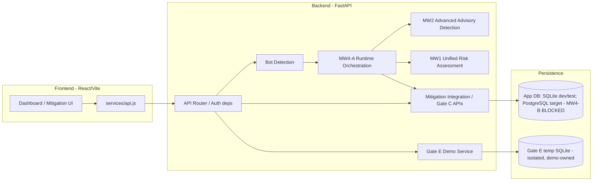
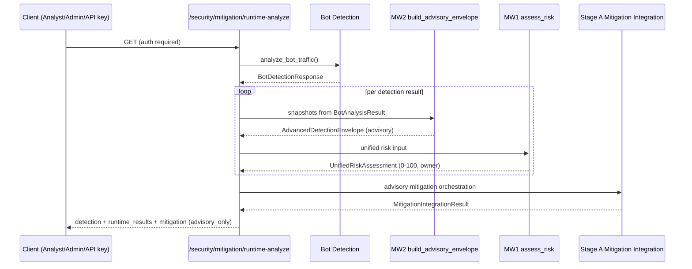
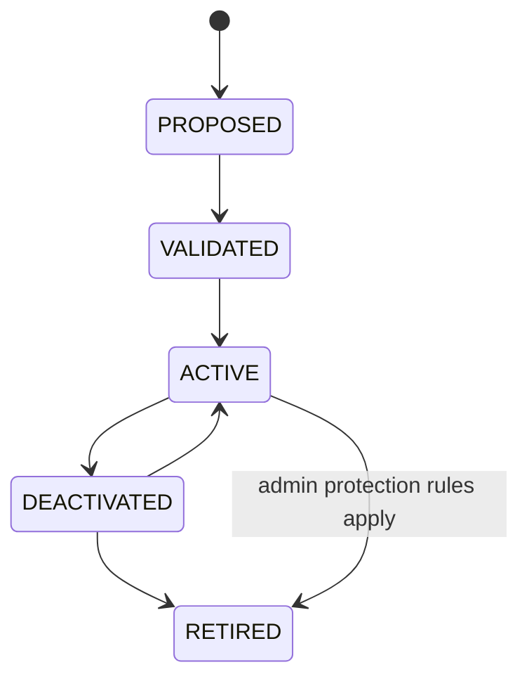
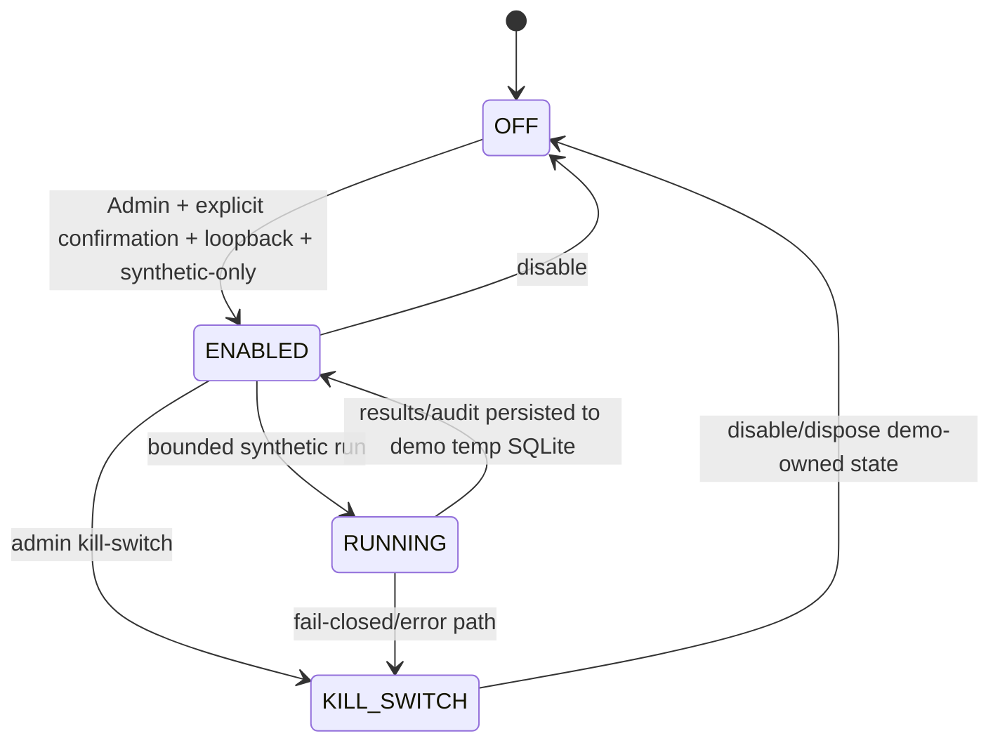

# APISentry MW4-C P1 — Architecture and Integration (Verified Scope)

> Status: evidence-backed documentation for the local prototype. Not a production certification.

## 1. System purpose
APISentry is a local FastAPI + React prototype for API traffic analysis, advisory threat detection, unified risk assessment, mitigation policy lifecycle management, and a default-off synthetic local enforcement demonstration (Gate E).

## 2. High-level architecture

## 3. Runtime orchestration flow (MW4-A)

## 4. MW1/MW2 ownership boundaries
- **MW1** (`unified_risk_assessment_service.py`): sole owner of bounded 0–100 unified risk score and severity classification. Produces contributions, reasons, signal statuses, coverage, uncertainty, provenance, evidence refs. No fabricated confidence/probability; no raw payload echoes.
- **MW2** (`advanced_detection/advisory_orchestrator.py`): separate advisory envelope with 7 signal analyzers, bounded contributions, structured statuses, opaque evidence refs. No raw credentials/headers/cookies/payload exposure.
- **MW4-A** composes MW2 then MW1 per result; does not create a combined score.

## 5. Mitigation policy lifecycle (Gate A/B/C)

- Gate A: lifecycle service (propose/validate/activate/deactivate/retire/dry-run evaluate). Advisory-only decisions.
- Gate B: persistence service (SQLite-safe tests; PostgreSQL target BLOCKED).
- Gate C: authenticated read/admin APIs; RBAC server-side authoritative.

## 6. Gate E local demo lifecycle

Safety: default OFF, loopback-only, synthetic-only, explicit confirmation, temp SQLite demo-owned, kill switch effective, no PG/original DB, no external exposure, no real enforcement.

## 7. Auth/RBAC boundaries
- `require_api_key`: system-to-system static key.
- `require_jwt_auth` / `get_current_user`: verified JWT, DB-preferred identity, registry/claims fallback, active account check.
- `RequireRole`: server-side RBAC (`admin`, `analyst`, `viewer`).
- `require_analyst_or_api_key`: protects security analysis routes; viewer JWT rejected (403); missing auth rejected (401/503).
- Frontend role gating is display-only; backend is authoritative.

## 8. Persistence architecture
- App DB: SQLAlchemy models; dev/test SQLite; PostgreSQL intended but **MW4-B BLOCKED/NO-GO** (ambiguous liveval pgdata/process state preserved; no PG actions in P1).
- Gate E: isolated temporary SQLite under system temp (configurable `MITIGATION_DEMO_DB_DIR`, temp-contained guard). Demo-owned; disposed on disable/reset.

## 9. Advisory vs enforcement boundaries
- MW1/MW2/MW4-A/mitigation analyze/runtime-analyze: **advisory only**, no enforcement.
- Gate E: isolated local demo-only enforcement simulation on synthetic requests in demo-owned temp SQLite. Not production enforcement; default OFF; kill switch/dispose required.

## 10. Known gaps (honest)
- MW4-B PostgreSQL persistence/auth E2E: BLOCKED.
- Full authenticated browser E2E: NOT VERIFIED in this P1 run unless explicitly executed with evidence.
- Production accuracy/performance/capacity: NOT MEASURED/NOT CLAIMED.
- Benchmark/eval in P1 are synthetic and bounded.